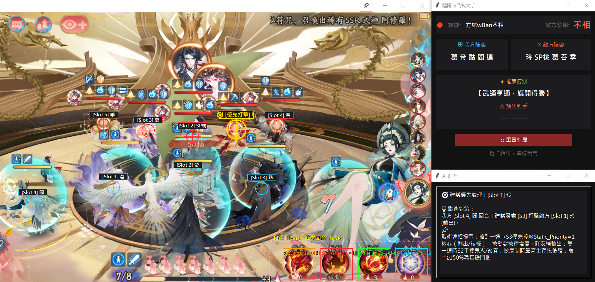
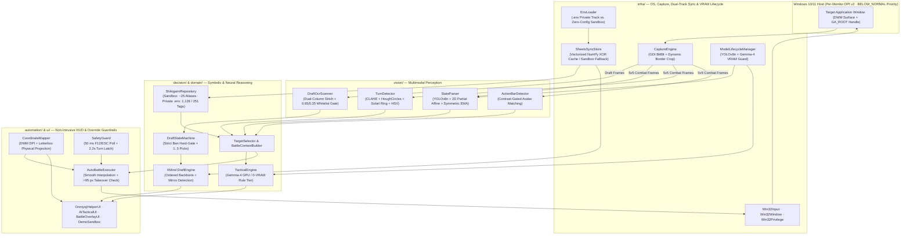
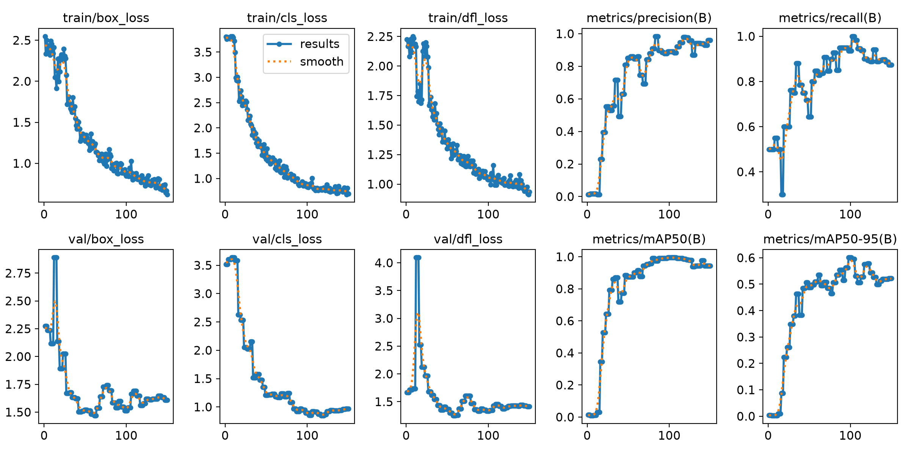

# Onmyoji Tactical Helper — Real-Time Computer Vision & Edge-AI Desktop Automation System

*Combining custom YOLOv8n 2D-affine spatial tracking, RapidOCR, rule-based dependency-aware XMind decision trees, and local quantized Gemma-4 LLM inference within a production-oriented 7-layer modular desktop architecture.*

[](https://github.com/alexmyc/onmyoji-tactical-helper/actions/workflows/ci.yml)
[](https://github.com/alexmyc/onmyoji-tactical-helper/releases/tag/v1.0.0)
[](https://www.python.org/)
[](docs/model_artifacts/)
[](https://github.com/abetlen/llama-cpp-python)
[](https://github.com/RapidAI/RapidOCR)
[](pyproject.toml)
[](LICENSE)

---

## Overview

**Onmyoji Tactical Helper** is a real-time computer vision, multimodal tactical decision-support, and desktop UI automation system engineered around competitive PvP drafting and 5v5 turn-based combat in *Onmyoji (陰陽師)*. Its centerpiece is **non-intrusive visual HUD telemetry and live tactical reasoning (Yellow Mode)**—executing a 100% local perception-and-decision pipeline alongside a 60 FPS DirectX client without inducing frame drops, scaling from GPU-accelerated **Gemma-4** inference down to a **zero-VRAM deterministic rule engine** on integrated graphics laptops.

> **Interactive Evaluation in 10 Seconds — No Game Client, GPU, or `.env` Required:**  
> Run `python run_app.py --demo` after cloning to launch the **Interactive Match Sandbox**, stepping through Ban/Pick counter-chains, stolen-card dead-branch pivots, mirror-match detection, and 5v5 turn telemetry on the live UI windows.

---

## Live In-Action Preview

### 1. Yellow Mode (Primary Showcase) — Non-Intrusive Tactical Advisor & Turn-Specific Guidance

*Yellow Mode (`WS_EX_NOACTIVATE` floating HUD, zero mouse/keyboard intervention): bridges locked Ban/Pick draft context with real-time turn detection, guiding ally `[Slot 4] 閻` to cast `[S3]` single-target morph/silence onto priority enemy `[Slot 1] 玲`.*

### 2. Full Spatial HUD Telemetry — 5v5 Unit Tracking & Skill Bar Geometry (`125% DWM DPI`)

*Live 5v5 PvP spatial tracking on a `1920×1200 @ 125% DWM DPI` display: custom `YOLOv8n` + 2D partial-affine tracking locks ally slots (`[Slot 1..4]` cyan rings), enemy slots (`[Slot 2..5]` red rings), and primary target crosshair (`🎯 [優先打擊] 玲`), paired with circumferential Sobel-verified `Skill Bar` button states (`S1..S4`), post-draft `MainWindow` (top-right), and floating `AI Tactical Advisor` (bottom-right).*

---

## Key Engineering Highlights

- **Multimodal Edge-AI Perception & Reasoning**
  - **Ban/Pick Drafting Phase**: Pairs horizontally stitched dual-column `RapidOCR` (two-tier whitelist confidence filtering: `0.65` general / `0.35` for single-character shikigami like `季`, `瀧`, `離`, `神`) with a deterministic `DraftStateMachine` enforcing a strict **Ban Hard-Gate** before feeding a **rule-based, dependency-aware XMind Counter Engine** (`ordered 5-step ally backbones` + `order-invariant enemy sets` + `dead-branch viability decay` + `mirror/copycat playbook detection`).
  - **5v5 Combat Phase**: Fuses **custom-trained `YOLOv8n`** unit detection, `cv2.estimateAffinePartial2D` camera-shake compensation, symmetric **3.5s ultimate-VFX occlusion EMA memory**, circumferential Sobel-verified `HoughCircles` turn/skill-slot geometry, and contrast-gated avatar template matching.
  - **Hardware-Tiered Local LLM**: Profiles CUDA VRAM and host RAM at runtime to offload **Gemma-4 (`Q4_K_M` GGUF)** onto NVIDIA GPUs or fall back transparently to a zero-latency, zero-VRAM symbolic rule engine.

- **OS-Level Symbiosis & Low-Overhead Scheduling**
  - Lowers its own Windows scheduling class to `BELOW_NORMAL_PRIORITY_CLASS` and caps OpenMP, MKL, OpenBLAS, OpenCV, and PyTorch worker pools (`1–2` threads) to prevent CPU contention against the foreground rendering thread.
  - Applies localized `120×80` Gaussian motion-diff gating to skip `> 75%` of redundant OCR passes on static frames, paired with phase-adaptive polling (`0.25s` active turn / `0.60s` enemy turn / `4.5s` in-battle idle) and deterministic `finally`-block GDI handle cleanup.

- **Mixed-DPI Coordinate Projection & Human-in-the-Loop Override Controls**
  - Shares a single physical coordinate projection (`project_cropped_to_physical_client`) across the click-through HUD (`WS_EX_LAYERED | WS_EX_TRANSPARENT | WS_EX_NOACTIVATE`) and UI dispatch layer—maintaining 1:1 pixel alignment across `100% / 125% / 150% / 200%` DWM DPI scaling, `16:10` letterboxes, and negative-coordinate multi-monitor desktops.
  - Implements **deterministic fail-safe guardrails**: smoothstep cursor interpolation with UI hover stabilization (`35–50 ms` `MOUSEEVENTF_MOVE` hover pulse for reliable hitbox registration), unified 2-step skill dispatch (`[unit lock] -> [skill cast]`) with automatic `S1` fallback on orb shortage, UIPI privilege-mismatch inspection, and **human-in-the-loop override controls** (`SafetyGuard` polls `F12` / `ESC` every `50 ms`, while `Win32Input` checks for `> 95 px` manual cursor takeover between interpolation steps).

- **Dual-Track Data Isolation & Native `.pyd` Packaging**
  - **Public Sandbox vs. Private Cloud Sync**: Public Sandbox Mode (`--demo` or default when `.env` is absent) bundles **27 curated sample aliases, 13 shikigami combat profiles, and 2 sample playbooks** (`public_demo_data.py`) for instant zero-config evaluation; configuring an untracked local `.env` dynamically syncs the full **1,128-entry alias dictionary and 251 shikigami tag profiles** from external Google Sheets.
  - **Native Binary Compilation (Source Obfuscation & Packaging)**: `build_release.py` compiles all **33 layered package modules** sequentially in isolated child processes via **Cython 3.3 + MSVC** (`/O2 /DNDEBUG`, `/DEBUG:NONE`, stripped docstrings and C line traces) into Windows `.pyd` C-extensions packaged as `OnmyojiHelper.exe` + `data/`.

---

## System Architecture

The codebase enforces a unidirectional **7-layer modular architecture** (`app / ui` -> `decision / vision / automation` -> `domain / infra`), decoupling core decision trees, state machines, and spatial trackers from Win32 and Tkinter APIs for deterministic offline testing.



> Detailed mathematical formulations (XMind dead-branch viability decay, quadratic branch sharpening, 2D affine occlusion recovery, DWM mixed-DPI coordinate projection, and thread synchronization invariants) are provided in the [System Architecture Guide](docs/ARCHITECTURE.md).

---

## Verifiable `YOLOv8n` Training Artifacts & Performance Benchmarks

### 1. Detection, Tracking & Recognition Metrics
Full Ultralytics training configuration ([args.yaml](docs/model_artifacts/args.yaml)), per-epoch logs ([results.csv](docs/model_artifacts/results.csv)), label distribution ([labels.jpg](docs/model_artifacts/labels.jpg)), PR/F1 curves ([BoxPR_curve.png](docs/model_artifacts/BoxPR_curve.png), [BoxF1_curve.png](docs/model_artifacts/BoxF1_curve.png)), and confusion matrices ([confusion_matrix.png](docs/model_artifacts/confusion_matrix.png), [confusion_matrix_normalized.png](docs/model_artifacts/confusion_matrix_normalized.png)) are archived in [`docs/model_artifacts/`](docs/model_artifacts/) (binary `.pt` weights and raw screenshot datasets remain git-ignored).

- **Dataset & Train/Val Split**: Focused isometric 5v5 PvP dataset comprising **16 training scenes (`121` annotated unit boxes: `62 enemy`, `59 ally`; `batch=4`, `imgsz=640`)** and a held-out **validation split (`20` unit boxes: `10 enemy`, `10 ally`)**. Transfer-trained from `yolov8n.pt` for `150 epochs` (`110.1s` on CUDA) using `randaugment`, `mosaic=1.0` (`close_mosaic=10`), `erasing=0.4`, `hsv_h=0.015, hsv_s=0.70, hsv_v=0.40`, `translate=0.10, scale=0.20, fliplr=0.50`. Best checkpoint selected at **Epoch 98**.



| Perception / Reasoning Module | Verifiable Metric | Technical Design Note |
| :--- | :---: | :--- |
| **`YOLOv8n` 5v5 Unit Detector (Epoch 98)** | **`mAP@50`: `99.5%`** · **`Precision`: `89.0%`** · **`Recall`: `93.5%`** · **`mAP@50-95`: `60.1%`** | Exact row 98 in [results.csv](docs/model_artifacts/results.csv); tight-IoU variance from ornate skins/halos is smoothed downstream by EMA + affine slot anchors |
| **Noisy 2D Affine + `3.5s` Occlusion Tracker (`StateParser`)** | **`100%` slot retention** (`< 10 px` mean error under `±4 px` jitter + dropouts) | `cv2.estimateAffinePartial2D` + EMA suppresses detection jitter by `> 35%` and bridges `< 3.5s` ultimate-VFX blackouts (`tests/test_vision_synthetic_regression.py`) |
| **Turn & Skill-Bar Verifier (`TurnDetector`)** | **16-pt Sobel ring (`>= 7/16` hits) + HSV gate** | Rejects full-screen flashbang washouts (`0` false triggers in synthetic regression) while resolving 3- vs. 4-skill button layouts |
| **Draft `RapidOCR` Whitelist Gate** | **`1.30x` linear ROI upscale + `0.65 / 0.35` two-tier gate** | Drops `< 0.65` background noise while preserving `0.35..0.65` single-char shikigami (`季`, `瀧`, `離`, `神`) prior to bounded alias matching |

### 2. Reproducible Offline Microbenchmarks (`P50 / P95 / P99`)
Measured offline on Python `3.12.1` (`Windows x64`) via [scripts/run_benchmarks.py](scripts/run_benchmarks.py) — reproduce locally anytime with `python scripts/run_benchmarks.py` (raw output in [docs/BENCHMARKS.json](docs/BENCHMARKS.json)):

| Pipeline Stage (`scripts/run_benchmarks.py`) | P50 (ms) | P95 (ms) | P99 (ms) | Mean (ms) |
| :--- | :---: | :---: | :---: | :---: |
| **`xmind_counter_tree_scoring`** (viability decay + mirror check) | **`0.077`** | **`0.081`** | **`0.093`** | `0.077` |
| **`shikigami_repo_lru_lookup`** (`@lru_cache` tag query) | **`< 0.001`** | **`0.001`** | **`0.001`** | `< 0.001` |
| **`noisy_2d_affine_spatial_tracker`** (`±4 px` noise + affine + EMA) | **`0.322`** | **`0.359`** | **`0.387`** | `0.324` |
| **`mixed_dpi_coordinate_projection`** (`125% DPI` + `16:10` letterbox) | **`0.004`** | **`0.007`** | **`0.007`** | `0.004` |
| **`draft_roi_motion_diff_gate`** (`120×80` Gaussian absdiff gate) | **`0.025`** | **`0.040`** | **`0.045`** | `0.031` |
| **`turn_detector_sobel_hsv_full_pass`** (`1280×720` Hough + Sobel + HSV) | **`2.787`** | **`3.623`** | **`4.416`** | `2.901` |

*Live runtime reference (RTX 3080 Laptop GPU, `1920×1200 @ 125% DPI`): GDI `BitBlt` + border crop `~1.8 ms`, `YOLOv8n` forward pass `~8 ms` (CUDA `640px`) / `~28 ms` (CPU `480px`), `SafetyGuard` hotkey poll `50 ms`, idle background CPU `< 1.5%`.*

---

## Tri-State Operating Modes

Click the status indicator dot in the top-left corner of the main window to cycle modes:

- 🟢 **Green Mode (Draft Decision Support)** — Runs Ban/Pick OCR, XMind counter recommendations, and opponent predictions with **0 MB GPU VRAM** footprint.
- 🟡 **Yellow Mode (Passive Visual HUD + Tactical Advisor — Primary Showcase)** — Loads `YOLOv8n` and Gemma-4 (or 0-VRAM rules) on 5v5 battle entry, rendering click-through (`WS_EX_TRANSPARENT | WS_EX_NOACTIVATE`) target lock rings, skill availability boxes, and live tactical advice with **zero input injection**.
- 🔴 **Red Mode (Closed-Loop UI Automation Research)** — Studies closed-loop coordinate projection and 2-step UI dispatch (`[unit lock -> skill cast]`) with smooth cursor interpolation, UI hover stabilization, and `S1` orb-shortage fallback. Pressing **`F12`**, **`ESC`**, or moving the physical mouse (`> 95 px`) yields control back to passive Yellow Mode.

---

## Quick Start

### 1. Instant Offline Interactive Demo (Recommended for Reviewers)
No game installation, external model weights, UAC elevation, or `.env` configuration required:
```powershell
pip install -r requirements.txt
python run_app.py --demo
```
Opens the **Draft Window**, **AI Tactical Panel**, and **Interactive Match Sandbox** side-by-side using the built-in Public Sandbox dataset (`~25` sample aliases, `2` playbooks) with real-time English inspector telemetry.

### 2. Run QA Gate (Tests, `>=70%` Core Coverage, Mypy, Ruff & Benchmarks)
Install QA/development tools from `requirements-dev.txt` and run all **29** offline tests:
```powershell
pip install -r requirements-dev.txt
pytest -v --cov=onmyoji_helper --cov-report=term-missing --cov-fail-under=70
mypy src
ruff check src tests scripts run_app.py build_release.py
python scripts/run_benchmarks.py
```

### 3. Live HUD Execution & Optional Private Cloud Sync (`.env`)
- **Public Sandbox Mode (Default)**: Launching `python run_app.py` without `.env` loads the built-in sample dataset (`public_demo_data.py`).
- **Private Cloud Mode**: Copy `.env.example` to `.env` (git-ignored) and configure your Google Sheets IDs (`1,128` aliases / `251` unit tags) and license CSV URL. Launching `start.bat` or `python run_app.py` requests Windows UAC elevation (for inspecting elevated DirectX windows under Windows UIPI) and syncs your live tables.

### 4. Native Binary Compilation (`OnmyojiHelper.exe` + `data/`)
```powershell
# Lite Build (0-VRAM rule tier, excludes 3 GB GGUF weights)
python build_release.py

# Full Build (Bundles local Gemma-4 GGUF weights + llama-cpp-python)
python build_release.py --full
```
Generates `dist\OnmyojiHelper\` containing **`OnmyojiHelper.exe`** and **`data\`** (all 33 compiled `.pyd` C-extensions + local model assets, verified for zero `.py` source residue).

---

## Repository Structure

```text
onmyoji-tactical-helper/
├── README.md                          # System overview, live previews, YOLOv8n curves & benchmarks
├── .env.example                       # Optional private cloud sync & license config template
├── requirements.txt                   # Pure runtime dependencies
├── requirements-dev.txt               # QA, test coverage, typing & native packaging tools
├── pyproject.toml                     # PEP 621 metadata (v1.0.0) + Ruff, Mypy & Coverage config
├── docs/
│   ├── ARCHITECTURE.md                # System Architecture Guide (math models, CV & concurrency)
│   ├── BENCHMARKS.json                # Reproducible P50 / P95 / P99 offline latency measurements
│   ├── model_artifacts/               # Verifiable YOLOv8n args.yaml, results.csv, PR/F1 & matrices
│   └── image/                         # Live 125% DPI Yellow & Red Mode HUD screenshots
├── scripts/
│   └── run_benchmarks.py              # Reproducible latency benchmark harness
├── run_app.py                         # Pre-import DPI & conditional UAC bootstrapper
├── build_release.py                   # Low-RAM Cython 3.3 .pyd compiler & PyInstaller packager
├── src/
│   └── onmyoji_helper/
│       ├── domain/                    # Pure models, Public Sandbox data & ShikigamiRepository
│       ├── decision/                  # DraftStateMachine, XMind DraftEngine, TargetSelector, LLM
│       ├── vision/                    # StateParser (2D affine), TurnDetector, ActionBar, OCR
│       ├── automation/                # CoordinateMapper, SafetyGuard & AutoBattleExecutor
│       ├── infra/                     # EnvLoader, Win32 APIs, BitBlt, XOR cache sync & VRAM guard
│       ├── ui/                        # MainWindow, AITacticalUI, BattleOverlayUI & DemoSandbox
│       └── app/                       # Runtime bootstrap, ModeController & BattleCoordinator
├── tests/                             # Offline unit, E2E & noisy synthetic CV suite (29 tests)
└── .github/workflows/ci.yml           # GitHub Actions CI (Ruff + Mypy + Pytest >=70% Coverage)
```

---

## Disclaimer

This repository is published strictly **for educational and technical research purposes only**, focusing on edge-AI multimodal inference, real-time computer vision tracking under visual occlusion, mixed-DPI Win32 window compositing, and human-in-the-loop desktop UI engineering. It is an independent research prototype and is neither affiliated with nor endorsed by NetEase Games. Users are solely responsible for complying with the terms of service of any third-party software when experimenting with desktop automation features.

---

## License

Distributed under the [MIT License](LICENSE).
