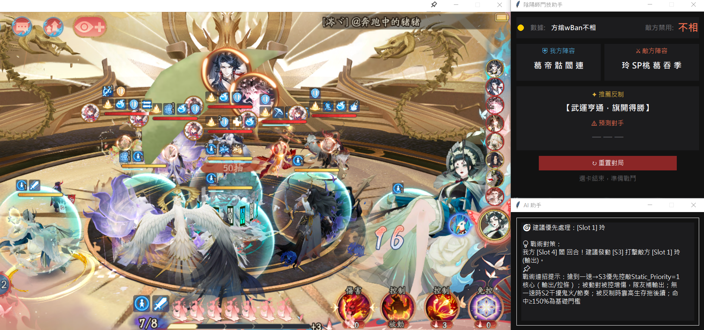
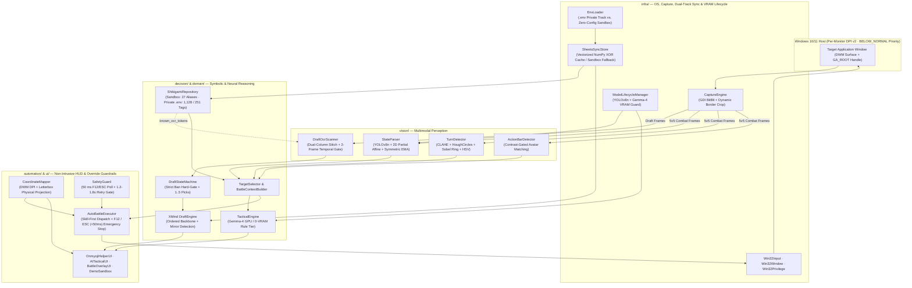

# Onmyoji Tactical Helper — Real-Time Computer Vision & Edge-AI Desktop Automation System

*Combining custom YOLOv8n 2D-affine spatial tracking, RapidOCR, rule-based dependency-aware XMind decision trees, and local quantized Gemma-4 LLM inference within a production-oriented 7-layer modular desktop architecture.*

[](https://github.com/alexmyc/onmyoji-tactical-helper/actions/workflows/ci.yml)
[](https://github.com/alexmyc/onmyoji-tactical-helper/releases/tag/v1.0.0)
[](https://www.python.org/)
[](LICENSE)
[](docs/model_artifacts/)
[](https://github.com/abetlen/llama-cpp-python)
[](https://github.com/RapidAI/RapidOCR)
[-brightgreen)](pyproject.toml)
[](docs/ARCHITECTURE.md#7-engineering-standards-alignment--multi-tier-test-governance)

---

## Overview

**Onmyoji Tactical Helper** solves a demanding systems-engineering problem: running **real-time multimodal computer vision, hybrid symbolic + edge-LLM decision-making, and mixed-DPI desktop HUD compositing** alongside a live 60 FPS DirectX tactical RPG (*Onmyoji*) on consumer hardware—with **zero cloud API latency, zero foreground frame drops, and graceful zero-VRAM fallback** on integrated-graphics laptops.

| Engineering Dimension | Production Implementation & Verifiable Metric |
| :--- | :--- |
| **Clean Architecture** | Unidirectional **7-layer modular Python 3.12 package** (`33` modules, Cython 3.3 `.pyd` native compilation) |
| **5v5 Vision & Tracking** | Custom `YOLOv8n` (**`99.5%` peak `mAP@50`**) + 2D partial-affine tracking + **Actionable Turn-UI baseline calibration** |
| **End-to-End Latency** | **`3.19 ms` P50** (`6.70 ms` P99) single-frame `1280×720` CV + Rule + HUD + `125%` DWM DPI pipeline |
| **Verification & Governance** | **`44/44` offline unit, E2E & noisy synthetic CV tests** (**`82.0%` core coverage**, `ISO/IEC 25010 · 27001 · 29119` aligned) |

> **Recruiter 10-Second Evaluation — Zero-Install Windows Portable Demo (`v1.0.0`):**
> 1. **Windows 10/11 (Fastest — Zero Setup)**: Download [**`OnmyojiHelper_HR_Demo_Win64.zip`**](https://github.com/alexmyc/onmyoji-tactical-helper/releases/latest/download/OnmyojiHelper_HR_Demo_Win64.zip) from [GitHub Releases (`v1.0.0`)](https://github.com/alexmyc/onmyoji-tactical-helper/releases/tag/v1.0.0), unzip, and double-click **`OnmyojiHelper.exe`**—no Python, game client, GPU, `.env`, or UAC elevation required.
> 2. **Cross-Platform Source Sandbox (Windows & Linux)**: Run `pip install numpy opencv-python && python run_app.py --demo`.
>
> Both options launch **three synchronized GUI windows** (*Interactive Match Sandbox*, *Live Draft & Mode View*, and *AI Tactical Advisor*) powered by the real production engines and built-in bilingual dataset (`27` aliases, `13` unit profiles, `2` playbooks). Step through Ban/Pick counter-chains, dead-branch pivots, mirror-match alerts, or toggle **Green / Yellow / Red** modes directly to inspect live engine telemetry.

---

## Live In-Action Preview

### 1. Yellow Mode (Primary Showcase) — Non-Intrusive Tactical Advisor & Turn-Specific Guidance

*Yellow Mode (`WS_EX_NOACTIVATE` floating HUD, zero mouse/keyboard intervention): bridges locked Ban/Pick draft context with real-time action-bar portrait matching and turn detection, guiding ally `[Slot 4]` (`SP Enma`) to cast `[S3]` single-target morph/silence onto priority enemy `[Slot 1]` (`Hatsune Miku`).*

### 2. Full Spatial HUD Telemetry — 5v5 Unit Tracking & Skill Bar Geometry (`125% DWM DPI`)

*Live 5v5 PvP spatial tracking on a `1920×1200 @ 125% DWM DPI` display: custom `YOLOv8n` + 2D partial-affine tracking locks ally slots (`[Slot 1..4]` cyan rings), enemy slots (`[Slot 2..5]` red rings), and the primary target crosshair (`Priority Target Lock`), paired with circumferential Sobel-verified `Skill Bar` button states (`S1..S4`), post-draft `MainWindow` (top-right), and floating `AI Tactical Advisor` (bottom-right).*

---

## Key Engineering Highlights

- **Multimodal Edge-AI Perception & Reasoning**
  - **Ban/Pick Drafting Phase**: Pairs adaptive-resolution dual-column `RapidOCR` (`400px` `INTER_LINEAR` upscale on shrunk `< 380px` ROIs, `1:1` native pixels at `720p–833p`, `440px` `INTER_AREA` downscale on `1080p+` ROIs + `10px` DBNet border padding) with **two-tier + 2-frame temporal consistency filtering** (`>= 0.42` immediate pass; `0.28..0.42` repository-injected single-character unit tokens require `2` consecutive frames to eliminate single-frame background hallucinations) and a deterministic `DraftStateMachine` enforcing Opening Ban + `25s` Post-5-Pick Extra-Ban tracking ahead of a **rule-based, dependency-aware XMind Counter Engine**.
  - **5v5 Combat Phase**: Prevents opening cutscene and pre-emptive realm camera skew via **Actionable Skill-Bar Turn-UI Calibration** (`is_my_turn == True` triggers clean `StateParser.reset_baseline()`, with an enemy-first `3.5s` provisional mode that forces a mandatory `reset_baseline()` recalibration on the first ally turn plus 5-enemy zero-drift self-healing), fused with **custom-trained `YOLOv8n`** detection, `cv2.estimateAffinePartial2D` camera-shake compensation, `0.115w` outer-slot perspective tolerance, symmetric **3.5s ultimate-VFX occlusion EMA memory**, circumferential Sobel-verified `HoughCircles` turn/skill geometry, and locked 5-pick avatar template matching (`CONF_THRESHOLD = 0.15`).
  - **Hardware-Tiered Local LLM**: Profiles CUDA VRAM and host RAM at runtime to offload **Gemma-4 (`Q4_K_M` GGUF)** onto NVIDIA GPUs or fall back transparently to a zero-latency, zero-VRAM symbolic rule engine.

- **OS-Level Symbiosis & Low-Overhead Scheduling**
  - Lowers its own Windows scheduling class to `BELOW_NORMAL_PRIORITY_CLASS` and caps OpenMP, MKL, OpenBLAS, OpenCV, and PyTorch worker pools (`1–2` threads) to prevent CPU contention against the foreground rendering thread.
  - Applies localized `120×80` `INTER_AREA` Gaussian mean + `99.5`th-percentile peak motion-diff gating to skip redundant OCR passes on static frames while catching localized card flips, paired with phase-adaptive polling (`0.20s` active turn / `0.35s` enemy turn / `4.5s` in-battle idle) and deterministic `finally`-block GDI handle cleanup.

- **Mixed-DPI Coordinate Projection & Human-in-the-Loop Override Controls**
  - Shares a single physical coordinate projection (`project_cropped_to_physical_client`) across the click-through HUD (`WS_EX_LAYERED | WS_EX_TRANSPARENT | WS_EX_NOACTIVATE`) and UI dispatch layer—maintaining 1:1 pixel alignment across `100% / 125% / 150% / 200%` DWM DPI scaling, `16:10` letterboxes, and negative-coordinate multi-monitor desktops.
  - Implements **deterministic fail-safe guardrails**: smoothstep cursor interpolation with UI hover stabilization (`35–50 ms` `MOUSEEVENTF_MOVE` hover pulse + pre-click cursor re-anchoring), skill-first 2-step dispatch (`[skill button] -> 0.20–0.28s -> [target unit]`) with a `1.0–1.5s` post-decision settle buffer, `1.2–1.8s` unfinished-turn retry loop capped by a **`MAX_TURN_RETRIES = 5` circuit breaker** (auto-downgrading to Yellow Mode if the client freezes), automatic `S1` fallback on orb shortage, UIPI privilege-mismatch inspection, and **`< 50 ms` `F12` / `ESC` human-in-the-loop emergency downgrade controls**.

- **Dual-Track Data Isolation & Credential-Free Default Packaging**
  - **Public Sandbox vs. Private Cloud Sync**: Public Sandbox Mode (`--demo` or default when `.env` is absent) bundles **27 curated sample aliases, 13 shikigami combat profiles, and 2 sample playbooks** (`public_demo_data.py`) for instant zero-config evaluation; configuring an untracked local `.env` dynamically syncs the full **1,128-entry alias dictionary and 251 shikigami tag profiles** from external Google Sheets.
  - **Native Binary Compilation (4 Standalone Release Profiles)**: `build_release.py` and `build_release.bat` provide a pure-ASCII 4-edition packager (`personal`, `hr-demo`, `friend-full`, `friend-lite`) compiling all **33 layered package modules** into native Windows `.pyd` C-extensions via **Cython 3.3 + MSVC** (`/O2 /DNDEBUG`, `/DEBUG:NONE`), explicitly bundling `.pyd`-hidden native libraries (`pywin32` / `pywintypes312.dll`, ONNX/CUDA runtimes per profile) and executing a live post-build **`OnmyojiHelper.exe --smoke-check`** verification gate before generating `OnmyojiHelper_HR_Demo_Win64.zip`.

---

## System Architecture

The codebase enforces a unidirectional **7-layer modular architecture** (`app / ui` -> `decision / vision / automation` -> `domain / infra`), decoupling core decision trees, state machines, and spatial trackers from Win32 and Tkinter APIs for deterministic offline testing.



> Detailed mathematical formulations (XMind dead-branch viability decay, quadratic branch sharpening, 2D affine occlusion recovery, DWM mixed-DPI coordinate projection, and thread synchronization invariants) are provided in the [System Architecture Guide](docs/ARCHITECTURE.md).

---

## Verifiable `YOLOv8n` Training Artifacts & Performance Benchmarks

### 1. Detection, Tracking & Recognition Metrics
Full Ultralytics training configuration ([args.yaml](docs/model_artifacts/args.yaml)), per-epoch logs ([results.csv](docs/model_artifacts/results.csv)), label distribution ([labels.jpg](docs/model_artifacts/labels.jpg)), PR/F1 curves ([BoxPR_curve.png](docs/model_artifacts/BoxPR_curve.png), [BoxF1_curve.png](docs/model_artifacts/BoxF1_curve.png)), and confusion matrices ([confusion_matrix.png](docs/model_artifacts/confusion_matrix.png), [confusion_matrix_normalized.png](docs/model_artifacts/confusion_matrix_normalized.png)) are archived in [`docs/model_artifacts/`](docs/model_artifacts/) (binary `.pt` weights and raw screenshot datasets remain git-ignored).

- **Dataset & Validation Split Disclosure**: Compact isometric 5v5 PvP dataset comprising **16 training scenes (`121` annotated unit boxes: `62 enemy`, `59 ally`; `batch=4`, `imgsz=640`)** and a **validation split (`20` unit boxes: `10 enemy`, `10 ally`, which was also used to select the peak checkpoint rather than a separate held-out test set)**. Transfer-trained from `yolov8n.pt` for `150 epochs` (`110.1s` on CUDA) with `randaugment`, `mosaic=1.0` (`close_mosaic=10`), `erasing=0.4`, `hsv_h=0.015, hsv_s=0.70, hsv_v=0.40`, `translate=0.10, scale=0.20, fliplr=0.50`:
  - **Peak Checkpoint — Epoch 98 (`best.pt`)**: **`mAP@50`: `99.5%`** · **`Precision`: `89.0%`** · **`Recall`: `93.5%`** · **`mAP@50-95`: `60.1%`**
  - **Final Epoch — Epoch 150 (`last.pt`)**: **`mAP@50`: `94.4%`** · **`Precision`: `95.9%`** · **`Recall`: `87.4%`** · **`mAP@50-95`: `52.2%`**


| Perception / Reasoning Module | Verifiable Metric | Technical Design Note |
| :--- | :---: | :--- |
| **`YOLOv8n` 5v5 Unit Detector (`best.pt` / `last.pt`)** | **Peak Ep.98 `mAP@50`: `99.5%` (`mAP@50-95`: `60.1%`)** · **Final Ep.150 `mAP@50`: `94.4%` (`mAP@50-95`: `52.2%`)** | Validation split metrics in [results.csv](docs/model_artifacts/results.csv); tight-IoU variance from ornate skins/halos is smoothed downstream by EMA + affine slot anchors |
| **Noisy 2D Affine + `3.5s` Occlusion Tracker (`StateParser`)** | **`100%` slot retention** (`< 10 px` mean error under `±4 px` jitter + dropouts) | `cv2.estimateAffinePartial2D` + EMA suppresses detection jitter by `> 35%` and bridges `< 3.5s` ultimate-VFX blackouts (`tests/test_vision_synthetic_regression.py`) |
| **Turn & Skill-Bar Verifier (`TurnDetector`)** | **16-pt Sobel ring (`>= 7/16` hits) + HSV gate** | Rejects full-screen flashbang washouts (`0` false triggers in synthetic regression) while resolving 3- vs. 4-skill button layouts |
| **Draft `RapidOCR` Temporal Whitelist Gate** | **`>= 0.42` immediate · `0.28..0.42` 2-frame streak** | Adaptive `400–440px` ROI scaling + `2`-frame verification filters 1-frame background flickers while confirming single-char picks, Opening Bans & Post-5-Pick Extra Bans |

### 2. Reproducible Offline Microbenchmarks & End-to-End Pipeline Latency (`P50 / P95 / P99`)
Measured offline on Python `3.12.1` (`Windows x64`) via [scripts/run_benchmarks.py](scripts/run_benchmarks.py) — reproduce locally anytime with `python scripts/run_benchmarks.py` (raw output in [docs/BENCHMARKS.json](docs/BENCHMARKS.json)):

| Pipeline Stage (`scripts/run_benchmarks.py`) | P50 (ms) | P95 (ms) | P99 (ms) | Mean (ms) |
| :--- | :---: | :---: | :---: | :---: |
| **`xmind_counter_tree_scoring`** (viability decay + mirror check) | **`0.078`** | **`0.105`** | **`0.142`** | `0.082` |
| **`shikigami_repo_lru_lookup`** (`@lru_cache` tag query) | **`0.001`** | **`0.001`** | **`0.001`** | `0.001` |
| **`noisy_2d_affine_spatial_tracker`** (`±4 px` noise + affine + EMA) | **`0.310`** | **`0.420`** | **`0.711`** | `0.336` |
| **`mixed_dpi_coordinate_projection`** (`125% DPI` + `16:10` letterbox) | **`0.003`** | **`0.005`** | **`0.006`** | `0.004` |
| **`draft_roi_motion_diff_gate`** (`120×80` `INTER_AREA` Gaussian absdiff gate) | **`0.504`** | **`0.579`** | **`1.574`** | `0.537` |
| **`turn_detector_sobel_hsv_full_pass`** (`1280×720` Hough + Sobel + HSV) | **`2.563`** | **`4.790`** | **`6.021`** | `2.844` |
| **`e2e_synthetic_frame_to_hud`** (`1280×720` Frame -> CV + Rule + HUD + `125%` DPI) | **`3.193`** | **`5.526`** | **`6.700`** | `3.464` |

*Live runtime reference (RTX 3080 Laptop GPU, `1920×1200 @ 125% DPI`): GDI `BitBlt` + border crop `~1.8 ms`, `YOLOv8n` forward pass `~8 ms` (CUDA `640px`) / `~28 ms` (CPU `480px`), `SafetyGuard` hotkey poll `50 ms`, idle background CPU `< 1.5%`.*

---

## Tri-State Operating Modes

Click the status indicator dot in the top-left corner of the main window to cycle modes:

- 🟢 **Green Mode (Draft Decision Support)** — Runs Ban/Pick OCR, XMind counter recommendations, and opponent predictions with **0 MB GPU VRAM** footprint.
- 🟡 **Yellow Mode (Passive Visual HUD + Tactical Advisor — Primary Showcase)** — Loads `YOLOv8n` and Gemma-4 (or 0-VRAM rules) on 5v5 battle entry, rendering click-through (`WS_EX_TRANSPARENT | WS_EX_NOACTIVATE`) target lock rings, skill availability boxes, and live tactical advice with **zero input injection**.
- 🔴 **Red Mode (Closed-Loop UI Automation Research)** — Studies closed-loop coordinate projection and skill-first 2-step UI dispatch (`[skill button] -> 0.20–0.28s -> [target unit]`) with `1.0–1.5s` camera-settle buffering, `1.2–1.8s` unfinished-turn retries (`MAX_TURN_RETRIES = 5` circuit-breaker downgrade), and `S1` orb-shortage fallback. Pressing **`F12`** or **`ESC`** yields control back to passive Yellow Mode in `< 50 ms`.

---

## Engineering Standards & Quality Assurance

This repository aligns its design, credential boundaries, and automated verification pipeline with international software engineering standards:

- **ISO/IEC 25010 (Software Product Quality)**:
  - *Functional Suitability*: Strict unidirectional **7-layer dependency graph** decoupling pure domain models, symbolic counter-trees, and finite-state machines from Win32 GDI/SendInput and Tkinter GUI layers.
  - *Performance Efficiency*: Deterministic sub-`4 ms` E2E perception-to-HUD latency (`P50 = 3.193 ms`), `120×80` `INTER_AREA` motion-diff OCR gating, `BELOW_NORMAL_PRIORITY_CLASS`, and `1–2` thread OpenMP/BLAS caps.
  - *Reliability*: Actionable `is_my_turn` skill-bar baseline calibration, `< 50 ms` `F12`/`ESC` hardware-polled emergency brake, `MAX_TURN_RETRIES = 5` per-turn circuit breaker, `S1` orb-shortage downgrade, and zero-VRAM deterministic rule fallback.
  - *Maintainability & Portability*: `Ruff` + `Mypy` static verification across all 41 source files, zero import-time side effects, and cross-platform Windows/Linux `--demo` interactive sandbox.
- **ISO/IEC 27001 & OWASP (Credential & Privilege Governance)**: Documented in [SECURITY.md](SECURITY.md) — enforces untracked `.env` secret isolation, credential-free default `.exe` packaging (`build_release.py`), conditional least-privilege Windows UAC elevation, and `%LOCALAPPDATA%` vectorized XOR cache obfuscation.
- **ISO/IEC/IEEE 29119 (Multi-Tier Test Governance)**: Documented in [docs/ARCHITECTURE.md](docs/ARCHITECTURE.md#7-engineering-standards-alignment--multi-tier-test-governance) — spans deterministic symbolic unit tests, noisy synthetic CV regression (`±4 px` jitter + `3.0s` occlusion + flashbang rejection), lifecycle/circuit-breaker integration, cross-platform `--demo` GUI smoke tests, and dependency-free headless CI gates.

---

## Recruiter Quickstart & Build Guide

### 1. Option A (Fastest — Zero-Install Windows 64-bit Portable Release)
Designed for Hiring Managers and technical reviewers on Windows 10/11 who want instant interactive evaluation with **zero Python setup, zero game client, zero model weights, zero `.env`, and zero UAC prompt**:
1. Download [**`OnmyojiHelper_HR_Demo_Win64.zip`**](https://github.com/alexmyc/onmyoji-tactical-helper/releases/latest/download/OnmyojiHelper_HR_Demo_Win64.zip) directly from [GitHub Releases (`v1.0.0`)](https://github.com/alexmyc/onmyoji-tactical-helper/releases/tag/v1.0.0).
2. Extract the archive and double-click **`OnmyojiHelper.exe`**.
3. The executable detects `data/demo_default.flag` and immediately opens the **Main Draft & Mode Window**, **AI Tactical Advisor**, and **Interactive Match Sandbox** side-by-side (`Offline Demo` dataset: `27` bilingual aliases, `13` combat profiles, `2` playbooks). Step through all 4 PvP scenarios, switch playbooks, or click **Green / Yellow / Red** modes on either window to inspect real-time engine decisions.

### 2. Option B (Cross-Platform Source Sandbox — Windows & Linux)
Run directly from source on Windows or Linux with no game window, GPU, external weights, or `.env`:
```bash
# Minimal cross-platform install for the offline interactive sandbox:
pip install numpy opencv-python

# Or install the full Windows CV + ONNX OCR runtime:
pip install -r requirements.txt

python run_app.py --demo
```

### 3. Run QA Gate (`44/44` Tests, Coverage Transparency, Mypy, Ruff & Benchmarks)
Install QA/development tools from `requirements-dev.txt` and run all **44** offline tests:
```powershell
pip install -r requirements-dev.txt
pytest -v --cov=onmyoji_helper --cov-report=term-missing --cov-fail-under=70
mypy src
ruff check src tests scripts run_app.py build_release.py
python scripts/run_benchmarks.py
```
- **Coverage Scope Transparency**: Headless CI enforces **`>= 70%`** coverage across the decoupled core decision, vision, domain, automation, and sync-parser layers (currently **`82.0%`** across `2,233` statements). Full-repository line coverage—when counting interactive Tkinter GUI windows, Win32 GDI/SendInput syscalls, and CUDA/GGUF model loaders—stands at **`61.2%`**.

### 4. Live HUD Execution & Optional Private Cloud Sync (`.env`)
- **Public Sandbox Mode (Default)**: Launching `python run_app.py` without `.env` loads the built-in sample dataset (`public_demo_data.py`: `27` aliases, `13` tags, `2` playbooks).
- **Private Cloud Mode**: Copy `.env.example` to `.env` (git-ignored) and configure your Google Sheets IDs (`1,128` aliases / `251` unit tags) and license CSV URL. Launching `start.bat` or `python run_app.py` requests Windows UAC elevation (for inspecting elevated DirectX windows under Windows UIPI) and syncs your live tables.

### 5. Multi-Edition Native Binary Compilation — 4 Standalone Profiles (`build_release.bat` / `build_release.py`)
`build_release.py` compiles all `33` package modules into native Cython `3.3` `.pyd` binaries across four isolated distribution profiles:

| Profile (`--profile`) | Output Artifact | Credentials & Privilege Policy | Bundled AI / Runtime Tier |
| :--- | :--- | :--- | :--- |
| **`personal`** (`[1]`) | `dist/OnmyojiHelper_Personal/` | Local `.env` + UAC Admin | `YOLOv8n` (`best.pt`) + `RapidOCR` + Local `.gguf` |
| **`hr-demo`** (`[2]`) | `dist/OnmyojiHelper_HR_Demo/` + **`OnmyojiHelper_HR_Demo_Win64.zip`** | **Zero `.env`** (`.env.example` only) · **No UAC** · `demo_default.flag` | Lightweight Offline Demo (`pywin32` + OpenCV + Symbolic Engine) |
| **`friend-full`** (`[3]`) | `dist/OnmyojiHelper_Friend_Full/` | Hardware Whitelist `.env` + `WARNING` log + UAC Admin | `YOLOv8n` + `RapidOCR` + Bundled `data/models/*.gguf` (CUDA) |
| **`friend-lite`** (`[4]`) | `dist/OnmyojiHelper_Friend_Lite/` | Hardware Whitelist `.env` + `WARNING` log + UAC Admin | `YOLOv8n` + `RapidOCR` + `FORCE_LITE_ENGINE=1` (0-VRAM Rule Tier) |

```powershell
pip install -r requirements.txt -r requirements-dev.txt

# Interactive 4-option pure-ASCII builder menu:
build_release.bat

# Or build a specific profile non-interactively:
python build_release.py --profile hr-demo --workers 2
python build_release.py --profile personal --workers 2
python build_release.py --profile friend-full --workers 2
python build_release.py --profile friend-lite --workers 2
```
Every build executes an automated 6-step post-build audit verifying clean root layout (`['OnmyojiHelper.exe', 'data']`), `33/33` compiled `.pyd` binaries, **zero `.py` source residue**, bundled `win32gui.pyd` / `pywintypes*.dll` integrity, strict credential-free isolation on `hr-demo`, and a live **`OnmyojiHelper.exe --smoke-check`** zero-crash startup check before `.zip` creation.

---

## Repository Structure

```text
onmyoji-tactical-helper/
├── README.md                          # System overview, live previews, YOLOv8n curves & benchmarks
├── SECURITY.md                        # ISO/IEC 27001 & OWASP credential isolation & disclosure policy
├── .env.example                       # Optional private cloud sync & license config template
├── requirements.txt                   # Pure runtime dependencies
├── requirements-dev.txt               # QA, test coverage, typing & native packaging tools
├── pyproject.toml                     # PEP 621 metadata (v1.0.0) + Ruff, Mypy & Coverage config
├── docs/
│   ├── ARCHITECTURE.md                # System Architecture Guide (math models, CV & concurrency)
│   ├── BENCHMARKS.json                # Reproducible P50 / P95 / P99 micro + E2E latency metrics
│   ├── model_artifacts/               # Verifiable YOLOv8n args.yaml, results.csv, PR/F1 & matrices
│   └── image/                         # Live 125% DPI Yellow & Red Mode HUD screenshots
├── scripts/
│   └── run_benchmarks.py              # Reproducible micro + single-frame E2E benchmark harness
├── run_app.py                         # Pre-import DPI & conditional UAC bootstrapper
├── build_release.bat                  # Pure-ASCII interactive 4-edition release builder menu
├── build_release.py                   # Multi-profile Cython 3.3 .pyd compiler & PyInstaller packager
├── src/
│   └── onmyoji_helper/
│       ├── domain/                    # Pure models, Public Sandbox data & ShikigamiRepository
│       ├── decision/                  # DraftStateMachine, XMind DraftEngine, TargetSelector, LLM
│       ├── vision/                    # StateParser (2D affine), TurnDetector, ActionBar, OCR
│       ├── automation/                # CoordinateMapper, SafetyGuard & AutoBattleExecutor
│       ├── infra/                     # EnvLoader, Win32 APIs, BitBlt, XOR cache sync & VRAM guard
│       ├── ui/                        # MainWindow, AITacticalUI, BattleOverlayUI & DemoSandbox
│       └── app/                       # Runtime bootstrap, ModeController & BattleCoordinator
├── tests/                             # Offline unit, E2E & noisy synthetic CV suite (44 tests)
└── .github/workflows/ci.yml           # GitHub Actions CI (Ruff + Mypy + Pytest >=70% Core Coverage)
```

---

## Disclaimer

This repository is published strictly **for educational and technical research purposes only**, focusing on edge-AI multimodal inference, real-time computer vision tracking under visual occlusion, mixed-DPI Win32 window compositing, and human-in-the-loop desktop UI engineering. It is an independent research prototype and is neither affiliated with nor endorsed by NetEase Games. Users are solely responsible for complying with the terms of service of any third-party software when experimenting with desktop automation features.

---

## License

Distributed under the [MIT License](LICENSE).
