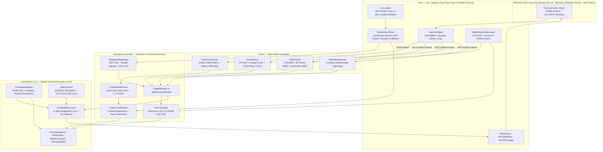

# Onmyoji Tactical Helper

**Real-Time Multimodal Edge-AI Tactical Assistant & Safety-Critical Automation Engine**  
*Fusing custom YOLOv8 2D-affine spatial tracking, RapidOCR, causal XMind counter-pick decision trees, and local quantized Gemma-4 LLM inference under strict single-PC frame and CPU budgets.*

[](https://www.python.org/)
[](https://github.com/ultralytics/ultralytics)
[](https://github.com/abetlen/llama-cpp-python)
[](https://github.com/RapidAI/RapidOCR)
[](https://cython.org/)
[](tests/)
[](pyproject.toml)
[](LICENSE)

---

## Overview

**Onmyoji Tactical Helper** is an end-to-end desktop AI system engineered for competitive real-time PvP drafting and 5v5 turn-based combat in *Onmyoji (陰陽師)*. Rather than relying on cloud LLM APIs or brittle static pixel macros, the engine executes a **100% local, multimodal perception-and-reasoning pipeline** alongside a live 60 FPS game client without inducing frame drops—dynamically scaling from GPU-accelerated **Gemma-4** reasoning on dedicated workstations down to a **zero-VRAM deterministic symbolic engine** on integrated graphics laptops.

> **Try It in 10 Seconds — No Game Client, GPU, or `.env` Required:**  
> Run `python run_app.py --demo` after cloning to launch the **Interactive Match Sandbox**, stepping live through Ban/Pick counter-chains, dead-branch viability pivots, mirror-match detection, and 5v5 tactical targeting on the real GUI windows.

---

## Live In-Action Preview

### 1. Red Mode — Live 5v5 Spatial Tracking, Skill Bar Geometry & Autonomous Targeting (`125% DPI`)

*Live 5v5 PvP combat on a `1920×1200 @ 125% DWM DPI` display: custom YOLOv8 + 2D partial-affine tracking locks ally slots (`[Slot 1..4]` cyan rings), enemy slots (`[Slot 2..5]` red rings), and primary kill-target crosshair (`🎯 [優先打擊] 玲`), paired with circumferential Sobel-verified `Skill Bar` button states (`S1..S4`), post-draft `MainWindow` (top-right), and non-activating `AI Tactical Advisor` (bottom-right).*

### 2. Yellow Mode — Non-Intrusive Tactical Advisor & Turn-Specific Combo Guidance

*Yellow Mode (`WS_EX_NOACTIVATE` floating HUD, zero mouse intervention): bridges locked Ban/Pick draft context with real-time turn detection, guiding ally `[Slot 4] 閻` to cast `[S3]` single-target morph/silence onto priority enemy `[Slot 1] 玲`.*

---

## Why This Project Stands Out (Engineering Highlights)

- **Hybrid Multimodal Edge-AI Pipeline**
  - **Ban/Pick Drafting Phase**: Pairs dual-column ROI-stitched `RapidOCR` (DirectML/CPU isolated) with a deterministic `DraftStateMachine` enforcing a strict **Ban Hard-Gate** before feeding an **XMind Tree-Structured Counter Engine** (`ordered 5-step ally backbones` + `order-invariant enemy sets` + `dead-branch viability decay` + `mirror/copycat playbook detection`).
  - **5v5 Combat Phase**: Fuses **custom-trained YOLOv8** unit detection, `cv2.estimateAffinePartial2D` camera-shake stabilization, symmetric **3.5s ultimate-VFX occlusion EMA memory**, circumferential Sobel-verified `HoughCircles` turn/skill-slot geometry, and contrast-gated avatar template matching.
  - **Hardware-Tiered Local LLM**: Inspects CUDA VRAM and host RAM at runtime to offload **Gemma-4 (`Q4_K_M` GGUF)** onto NVIDIA GPUs or seamlessly fall back to a zero-latency, zero-VRAM symbolic tactical engine.

- **OS-Level Symbiosis & Zero-Stutter Resource Scheduling**
  - Lowers its own Windows scheduling class to `BELOW_NORMAL_PRIORITY_CLASS` and caps OpenMP, MKL, OpenBLAS, OpenCV, and PyTorch worker pools (`1–2` threads) to prevent CPU sawtooth contention against the game render thread.
  - Applies localized `120×80` Gaussian motion-diff gating to bypass `> 75%` of redundant OCR passes on static frames, paired with phase-adaptive polling (`0.25s` active turn / `0.60s` enemy turn / `4.5s` in-battle sleep) and deterministic `finally`-block GDI handle cleanup.

- **Safety-Critical Win32 & Mixed-DPI Automation**
  - Shares a single physical projection (`project_cropped_to_physical_client`) across the click-through HUD (`WS_EX_LAYERED | WS_EX_TRANSPARENT | WS_EX_NOACTIVATE`) and `SendInput` executor—preserving 1:1 pixel accuracy across `100% / 125% / 150% / 200%` DWM DPI scaling, `16:10` letterboxes, and negative-coordinate multi-monitor desktops.
  - Executes humanized smoothstep Bezier trajectories with clamped Gaussian jitter, unified 2-step targeting (`[unit lock] -> [skill cast]`) across single-target and ally/enemy AoE skills, automatic `S1` normal-attack fallback on orb shortage, UIPI elevation mismatch detection, and a **`< 50 ms` `F12` / `ESC` / mouse-takeover emergency brake** that downgrades to passive HUD mode without unloading GPU VRAM.

- **Dual-Track Configuration & Hardened Native `.pyd` Packaging**
  - **Zero-Leak Dual-Track Isolation**: Private Google Sheets playbooks and hardware license endpoints live strictly in an untracked local `.env`; cloning the repository without `.env` transparently activates **Public Sandbox Mode** with built-in sample playbooks and meta shikigami combat profiles.
  - **Anti-Decompilation Release Builder**: `build_release.py` compiles all **33 layered package modules** sequentially in isolated child processes via **Cython 3.3 + MSVC** (`/O2 /DNDEBUG`, `/DEBUG:NONE`, stripped docstrings, C line traces, and function signatures), freezing into a minimalist `OnmyojiHelper.exe` + `data/` layout audited for **zero `.py` source leaks**.

---

## System Architecture

The codebase enforces a strict unidirectional **7-layer Clean Architecture** (`app / ui` -> `decision / vision / automation` -> `domain / infra`), keeping core decision trees, state machines, and spatial trackers 100% decoupled from Win32 and Tkinter for sub-second offline unit testing.



> Full mathematical formulations (XMind dead-branch viability decay, quadratic branch sharpening, 2D affine occlusion recovery, DWM mixed-DPI coordinate projection, and thread synchronization invariants) are detailed in [docs/ARCHITECTURE.md](docs/ARCHITECTURE.md).

---

## Engineering Benchmarks

Measured on Windows 10/11 x64 · NVIDIA GeForce RTX 3080 Laptop GPU (16 GB VRAM) · Dual-Monitor Mixed-DPI (`1920×1200 @ 125%` + `2560×1440 @ 100%`):

| Pipeline Stage | Latency / Cadence | Engineering Optimization & Isolation Strategy |
| :--- | :---: | :--- |
| **GDI `BitBlt` Capture + Vectorized Crop** | **`~1.8 ms`** | `np.any` `O(H+W)` border scan + deterministic `finally` GDI handle release |
| **Draft ROI Motion-Diff Gate** | **`< 0.3 ms`** | Skips `> 75%` of redundant `RapidOCR` calls on static frames (`3.0s` heartbeat) |
| **XMind Tree Scoring & Mirror Prediction** | **`< 1.2 ms`** | Pre-sorted multi-char tokenization + quadratic top-tier branch sharpening |
| **251-Unit Tag Lookup (`ShikigamiRepository`)** | **`< 0.02 ms` (`O(1)`)** | Single-pass vectorized XOR cache load + `@lru_cache(maxsize=512)` |
| **YOLOv8 Detection + 2D Affine Solve** | **`~8 ms` (GPU) / `~28 ms` (CPU)** | `torch.no_grad()` + adaptive `640px` (CUDA) / `480px` (iGPU/CPU) inference |
| **Emergency Kill-Switch (`F12` / `ESC`)** | **`< 50 ms`** | Dedicated daemon thread + epoch-guarded instant downgrade to passive HUD |
| **Idle Background CPU Utilization** | **`< 1.5%`** | `BELOW_NORMAL` process priority + `2.5s / 4.5s` adaptive sleep throttling |

---

## Tri-State Operating Modes

Click the status indicator dot in the top-left corner of the main window to cycle modes at any time:

- 🟢 **Green Mode (Draft Assistant Only)** — Runs Ban/Pick OCR, XMind counter recommendations, and opponent predictions with **0 MB GPU VRAM** footprint.
- 🟡 **Yellow Mode (Visual HUD + Tactical AI)** — Loads YOLOv8 and Gemma-4 (or 0-VRAM rules) on 5v5 battle entry, rendering click-through target lock rings, skill availability boxes, and live tactical advice with **zero mouse intervention**.
- 🔴 **Red Mode (Full Autonomous Execution)** — Executes humanized 2-step `[unit lock -> skill cast]` actions across single-target, enemy AoE, and ally AoE skills with automatic `S1` fallback. Pressing **`F12`**, **`ESC`**, or manually taking over the mouse immediately brakes and drops back to Yellow Mode.

---

## Quick Start

### 1. Instant Offline Interactive Demo (Recommended for Reviewers)
No game installation, GPU weights, UAC elevation, or `.env` configuration required:
```powershell
pip install -r requirements.txt
python run_app.py --demo
```
This opens the live **Draft Window**, **AI Tactical Panel**, and **Interactive Match Sandbox** side-by-side so you can step through counter-chains, stolen-card dead-branch pivots, mirror-match detection, and 5v5 turn decisions with real-time English engine telemetry.

### 2. Run Deterministic Test Suite & Static Linter
All 20 unit tests run offline in `< 0.5s`:
```powershell
pytest -v
ruff check src tests run_app.py build_release.py
```

### 3. Live Game Execution & Optional Private Cloud Sync (`.env`)
- **Public Sandbox Mode (Default)**: Running `python run_app.py` without a `.env` file automatically loads the built-in sandbox dataset (`public_demo_data.py`).
- **Private Cloud Mode**: Copy `.env.example` to `.env` (git-ignored) and populate your Google Sheets IDs and hardware license CSV URL. Launching `start.bat` or `python run_app.py` will automatically request Windows UAC Administrator elevation (preventing UIPI input blocking) and sync your live playbooks.

### 4. Build Hardened Native Release (`OnmyojiHelper.exe` + `data/`)
```powershell
# Lite Release (0-VRAM rule tier, excludes 3 GB GGUF weights)
python build_release.py

# Full Release (Bundles local Gemma-4 GGUF weights + llama-cpp-python)
python build_release.py --full
```
Output is generated in `dist\OnmyojiHelper\` containing strictly **`OnmyojiHelper.exe`** (embedded UAC `requireAdministrator` manifest) and **`data\`** (all 33 compiled `.pyd` extensions + model weights, zero `.py` source files).

---

## Repository Structure

```text
onmyoji-tactical-helper/
├── README.md                          # Project overview, live previews, architecture & benchmarks
├── .env.example                       # Optional private cloud sync & license config template
├── docs/
│   ├── ARCHITECTURE.md                # Mathematical models, concurrency & safety whitepaper
│   └── image/                         # Live 125% DPI Red & Yellow Mode combat screenshots
├── pyproject.toml                     # PEP 621 metadata + Ruff, Mypy & Pytest configuration
├── requirements.txt                   # Runtime, packaging & QA dependencies
├── run_app.py                         # Pre-import DPI & conditional UAC bootstrapper
├── start.bat                          # One-click Windows launcher
├── build_release.py                   # Low-RAM Cython 3.3 .pyd compiler & PyInstaller auditor
├── build_release.bat                  # Interactive Lite / Full native release builder
├── src/
│   └── onmyoji_helper/
│       ├── domain/                    # Pure models, Public Sandbox data & 251-unit Repository
│       ├── decision/                  # DraftStateMachine, XMind DraftEngine, TargetSelector, LLM
│       ├── vision/                    # StateParser (2D affine), TurnDetector, ActionBar, OCR
│       ├── automation/                # CoordinateMapper, SafetyGuard & AutoBattleExecutor
│       ├── infra/                     # EnvLoader, Win32 APIs, BitBlt, XOR cache sync & VRAM guard
│       ├── ui/                        # MainWindow, AITacticalUI, BattleOverlayUI & DemoSandbox
│       └── app/                       # Runtime bootstrap, ModeController & BattleCoordinator
├── tests/                             # Deterministic offline pytest suite (20 tests, < 0.5s)
└── .github/workflows/ci.yml           # Automated GitHub Actions CI (Ruff lint + Pytest)
```

---

## License

Distributed under the [MIT License](LICENSE). Engineered for computer vision, edge-AI systems architecture, and safety-critical human-computer interaction research.
