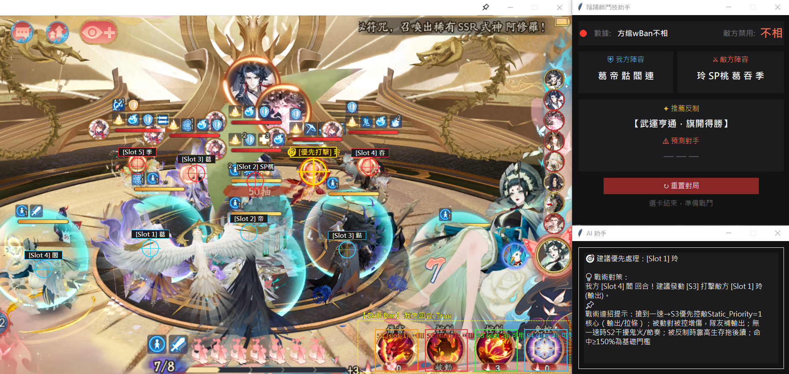
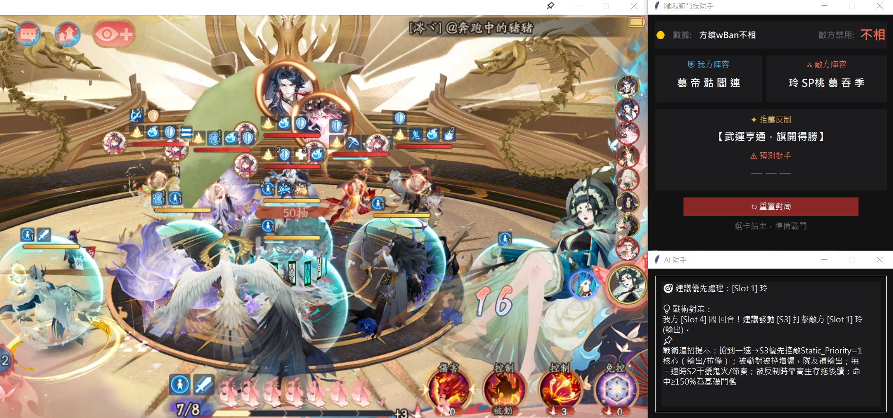
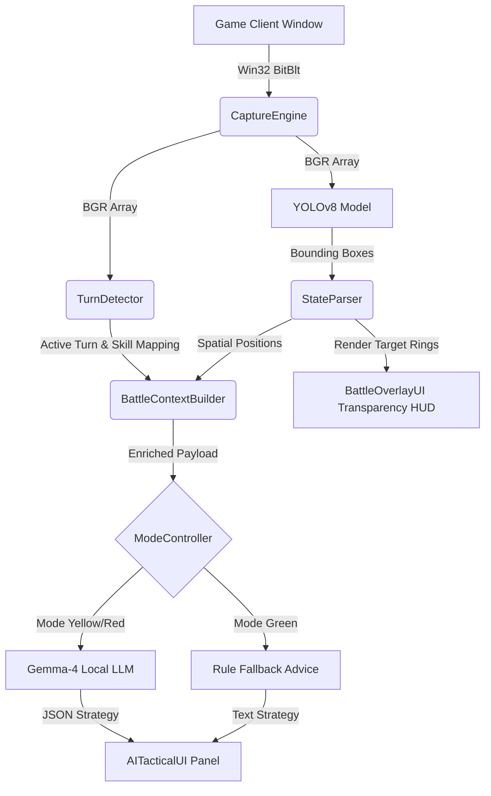

# ⚔️ Onmyoji Tactical Helper (陰陽師雙向戰術輔助系統)

[](https://www.python.org/)
[](https://opencv.org/)
[](https://ultralytics.com/)
[](https://cython.org/)
[](https://opensource.org/licenses/MIT)

An enterprise-grade, real-time tactical analytics and battle-assistant platform for *Onmyoji PvP (鬥技)*. Combines **YOLOv8 object detection**, **Gemma-4 quantized local LLM inference**, and **Windows GDI high-speed screen capture** into a zero-latency, multi-threaded assistant.

---

## 📸 System Showcase

| Main Dashboard & Transparent HUD Overlay | Real-Time AI Tactical Inference |
| :---: | :---: |
|  |  |

---

## 🌟 Key Features

### 1. 👁️ High-Performance Computer Vision Engine
- **60 FPS GDI BitBlt Capture**: Ultra-fast Win32 API screen capture (`CaptureEngine`) with dynamic black-border auto-cropping.
- **Skill Bar & Turn Debouncing**: Combines Hough Circle transform, CLAHE contrast enhancement, and HSV saturation analysis (`TurnDetector`) to recognize active skill slots while filtering animation flickering.
- **Spatial Tracking**: Bounding-box detection using **cv2.estimateAffinePartial2D** and Exponential Moving Average (EMA, $\alpha=0.30$) position smoothing (`StateParser`).

### 2. 🧠 Local LLM Tactical Decision Engine
- **Gemma-4 Integration**: Runs localized GGUF quant models (`gemma-4-E2B-it-Q4_K_M.gguf`) via `llama-cpp-python` with CUDA acceleration.
- **Hierarchical Fallback Pipeline**: Built-in smart rule engine guarantees sub-millisecond tactical responses if GPU memory limits or token truncation occurs.
- **Scope-Aware Targeting**: Context-driven `TargetSelector` algorithm handling single-target, AoE, self-buff, and team priority hierarchies.

### 3. 🛡️ Robust Architecture & Security
- **Non-Symmetric Scoring**: Draft recommendation engine (`logic.py`) calculating opponent counter-picks with frequency-weighted priority.
- **Thread-Safe State Machine**: Lock-guarded GPU memory release and mode transition controller (🟢 Green / 🟡 Yellow / 🔴 Red).
- **Cython Binary Compilation**: Core logic setup (`build_pyd.py`) ready for C-extension `.pyd` closed-source release pipeline.

---

## 🏗️ System Architecture



---

## 🛠️ Tech Stack

| Domain | Technology / Library |
| :--- | :--- |
| **Core Language** | Python 3.10+, C Extension (Cython) |
| **Computer Vision** | OpenCV (`cv2`), PyTorch, Ultralytics YOLOv8 |
| **Local AI / LLM** | `llama-cpp-python` (Gemma-4 GGUF, CUDA Acceleration) |
| **GUI & Overlay** | Tkinter, Windows API (`ctypes`, `win32gui`, `win32ui`) |
| **Data Synchronization** | Remote Google Sheets GViz CSV Parser + XOR Encrypted Local AppData Cache |

---

## 💎 Engineering Highlights & Design Patterns

- **Software Engineering Standards**: Fully compliant with **PEP 8**, standard **Google-Style Docstrings**, and comprehensive **PEP 484 Type Hints**.
- **Design Patterns Applied**:
  - **Singleton Pattern**: Managed UI overlay and tactical window state (`AITacticalUI`).
  - **State Pattern**: Handled multi-mode execution pipeline (`ModeController`).
  - **Strategy Pattern**: Dynamic switching between LLM inference and rule-based fallback engines (`TacticalEngine`).
- **Resource & Memory Management**: Explicit Windows GDI DC handle cleanup to prevent memory leaks during 60 FPS real-time capture loop.

---

## 🚀 Environment Setup

### 1. Prerequisites
- **OS**: Windows 10 / 11 (64-bit)
- **Python**: Version 3.10 or higher
- **GPU**: NVIDIA GPU with CUDA support (Recommended for LLM Acceleration)

### 2. Installation
```bash
# Clone repository
git clone https://github.com/alexmyc/onmyoji-tactical-helper.git
cd onmyoji-tactical-helper

# Install dependencies
pip install -r requirements.txt
```

### 3. Model Preparation
1. Place your trained YOLO weights file (`best.pt`) in the root directory.
2. Download `gemma-4-E2B-it-Q4_K_M.gguf` and place it in the root or `models/` directory.

### 4. Running Application
```bash
python main.py
```

---

## 🔒 Security & Desensitization
- **Zero Hardcoded Credentials**: API endpoints, authorization tokens, and sheet keys are fully modularized or environment-gated (`db_manager.py`, `auth_module.py`).
- **Hardware Binding**: SHA-256 CSPRODUCT UUID machine fingerprinting for multi-tier license validation.

---

## 📄 License
Distributed under the **MIT License**. See `LICENSE` for more information.