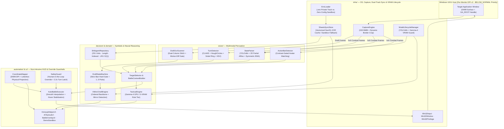

# Onmyoji Tactical Helper

**Real-Time Multimodal Tactical Decision Support & Desktop Automation Research**  
*Combining custom YOLOv8n 2D-affine spatial tracking, RapidOCR, causal XMind counter-pick decision trees, and local quantized Gemma-4 LLM inference within a production-oriented modular desktop architecture.*

[](https://www.python.org/)
[](https://github.com/ultralytics/ultralytics)
[](https://github.com/abetlen/llama-cpp-python)
[](https://github.com/RapidAI/RapidOCR)
[](https://cython.org/)
[](tests/)
[](pyproject.toml)
[](LICENSE)

---

## Overview

**Onmyoji Tactical Helper** is a local multimodal decision-support and desktop UI engineering research project built around competitive PvP drafting and 5v5 turn-based combat in *Onmyoji (陰陽師)*. Its primary focus is **non-intrusive visual HUD telemetry and real-time tactical reasoning (Yellow Mode)**—running a 100% local computer-vision and symbolic/neural inference pipeline alongside a live 60 FPS DirectX client without frame drops, scaling smoothly from GPU-accelerated **Gemma-4** inference down to a **zero-VRAM deterministic rule engine** on integrated graphics laptops.

> **Interactive Evaluation in 10 Seconds — No Game Client, GPU, or `.env` Required:**  
> Run `python run_app.py --demo` after cloning to launch the **Interactive Match Sandbox**, stepping through Ban/Pick counter-chains, stolen-card dead-branch pivots, mirror-match detection, and 5v5 turn telemetry on the live UI windows.

---

## Live In-Action Preview

### 1. Yellow Mode (Core Showcase) — Non-Intrusive Tactical Advisor & Turn-Specific Guidance

*Yellow Mode (`WS_EX_NOACTIVATE` floating HUD, zero mouse/keyboard intervention): bridges locked Ban/Pick draft context with real-time turn detection, guiding ally `[Slot 4] 閻` to cast `[S3]` single-target morph/silence onto priority enemy `[Slot 1] 玲`.*

### 2. Full Spatial HUD Telemetry — 5v5 Unit Tracking & Skill Bar Geometry (`125% DWM DPI`)

*Live 5v5 PvP spatial tracking on a `1920×1200 @ 125% DWM DPI` display: custom `YOLOv8n` + 2D partial-affine tracking locks ally slots (`[Slot 1..4]` cyan rings), enemy slots (`[Slot 2..5]` red rings), and primary target crosshair (`🎯 [優先打擊] 玲`), paired with circumferential Sobel-verified `Skill Bar` button states (`S1..S4`), post-draft `MainWindow` (top-right), and floating `AI Tactical Advisor` (bottom-right).*

---

## Key Engineering Highlights

- **Multimodal Edge-AI Perception & Reasoning**
  - **Ban/Pick Drafting Phase**: Pairs dual-column ROI-stitched `RapidOCR` (DirectML/CPU isolated) with a deterministic `DraftStateMachine` enforcing a strict **Ban Hard-Gate** before feeding an **XMind Tree-Structured Counter Engine** (`ordered 5-step ally backbones` + `order-invariant enemy sets` + `dead-branch viability decay` + `mirror/copycat playbook detection`).
  - **5v5 Combat Phase**: Fuses **custom-trained `YOLOv8n`** unit detection, `cv2.estimateAffinePartial2D` camera-shake compensation, symmetric **3.5s ultimate-VFX occlusion EMA memory**, circumferential Sobel-verified `HoughCircles` turn/skill-slot geometry, and contrast-gated avatar template matching.
  - **Hardware-Tiered Local LLM**: Profiles CUDA VRAM and host RAM at runtime to offload **Gemma-4 (`Q4_K_M` GGUF)** onto NVIDIA GPUs or fall back transparently to a zero-latency, zero-VRAM symbolic rule engine.

- **OS-Level Symbiosis & Low-Overhead Scheduling**
  - Sets its own Windows scheduling class to `BELOW_NORMAL_PRIORITY_CLASS` and caps OpenMP, MKL, OpenBLAS, OpenCV, and PyTorch worker pools (`1–2` threads) to prevent CPU contention against the foreground rendering thread.
  - Applies localized `120×80` Gaussian motion-diff gating to skip `> 75%` of redundant OCR passes on static frames, paired with phase-adaptive polling (`0.25s` active turn / `0.60s` enemy turn / `4.5s` in-battle idle) and deterministic `finally`-block GDI handle cleanup.

- **Mixed-DPI Coordinate Projection & Human-in-the-Loop Override Controls**
  - Shares a single physical coordinate projection (`project_cropped_to_physical_client`) across the click-through HUD (`WS_EX_LAYERED | WS_EX_TRANSPARENT | WS_EX_NOACTIVATE`) and UI automation research layer—maintaining 1:1 pixel alignment across `100% / 125% / 150% / 200%` DWM DPI scaling, `16:10` letterboxes, and negative-coordinate multi-monitor desktops.
  - Implements **deterministic fail-safe guardrails**: smoothstep cursor interpolation with UI hover stabilization (`35–50 ms` `MOUSEEVENTF_MOVE` hover pulse for reliable hitbox state registration), unified 2-step skill dispatch (`[unit lock] -> [skill cast]`) with automatic `S1` fallback on orb shortage, UIPI privilege-mismatch inspection, and **`< 50 ms` human-in-the-loop override controls** (`F12`, `ESC`, or physical mouse movement immediately disarms execution back to passive Yellow Mode).

- **Production-Oriented Modular Architecture & Native Binary Compilation**
  - **Dual-Track Configuration Isolation**: Optional private Google Sheets sync endpoints reside strictly in an untracked local `.env`; cloning the repository without `.env` automatically activates **Public Sandbox Mode** with built-in sample playbooks and meta shikigami profiles.
  - **Native Binary Compilation & IP Protection**: `build_release.py` compiles all **33 layered package modules** sequentially in isolated child processes via **Cython 3.3 + MSVC** (`/O2 /DNDEBUG`, `/DEBUG:NONE`, stripped docstrings and C line traces) into native Windows `.pyd` C-extensions, packaged into a clean `OnmyojiHelper.exe` + `data/` distribution verified for zero `.py` source residue.

---

## System Architecture

The codebase enforces a unidirectional **7-layer modular architecture** (`app / ui` -> `decision / vision / automation` -> `domain / infra`), decoupling core decision trees, state machines, and spatial trackers from Win32 and Tkinter APIs for deterministic offline testing.



> Mathematical formulations (XMind dead-branch viability decay, quadratic branch sharpening, 2D affine occlusion recovery, DWM mixed-DPI coordinate projection, and thread synchronization invariants) are documented in [docs/ARCHITECTURE.md](docs/ARCHITECTURE.md).

---

## Benchmarks & Model Accuracy Metrics

### 1. Detection, Tracking & Recognition Accuracy
Custom **`YOLOv8n`** (`best.pt`, `5.9 MB`, 2 classes: `{0: enemy, 1: ally}`) trained for `150 epochs` at `imgsz=640` with domain-specific heavy lighting/occlusion augmentations (`mosaic=1.0`, `hsv_h=0.015`, `hsv_s=0.70`, `hsv_v=0.40`, `translate=0.10`, `scale=0.20`, `fliplr=0.50`):

| Perception / Reasoning Module | Validation / Replay Metric | Technical Design Note |
| :--- | :---: | :--- |
| **`YOLOv8n` 5v5 Unit Detector (`best.pt`)** | **`mAP@50`: `99.5%`** · **`Recall`: `93.5%`** · **`Precision`: `89.0%`** (`mAP@50-95`: `60.1%`) | High recall prioritizes unit center localization; bounding-box variance from ornate skins/auras is stabilized downstream by EMA + affine anchors |
| **2D Affine + `3.5s` Occlusion Tracker (`StateParser`)** | **`100%` slot retention** (`<= 4 px` drift in replay suite) | `cv2.estimateAffinePartial2D` reconstructs occluded slots whenever `>= 3` teammates/enemies remain visible during `< 3.5s` ultimate VFX |
| **Turn & Skill-Bar Verifier (`TurnDetector`)** | **16-pt Sobel ring (`>= 7/16` hits) + HSV gate** | Rejects full-screen flashbang/explosion washouts (`0` false triggers in replay regression) while resolving 3- vs. 4-skill layouts |
| **Draft `RapidOCR` + Alias Normalization** | **`2.0x` cubic upscale (`H < 900`) + `1,128` aliases** | Dual-column stitched pass + length-descending alias matching + strict `Ban` hard-gate preventing pre-Ban pick pollution |

### 2. Runtime Latency & Resource Overhead
Measured on Windows 10/11 x64 · NVIDIA GeForce RTX 3080 Laptop GPU (16 GB VRAM) · Dual-Monitor Mixed-DPI (`1920×1200 @ 125%` + `2560×1440 @ 100%`):

| Pipeline Stage | Latency / Cadence | Engineering Optimization & Isolation Strategy |
| :--- | :---: | :--- |
| **GDI `BitBlt` Capture + Vectorized Crop** | **`~1.8 ms`** | `np.any` `O(H+W)` border scan + deterministic `finally` GDI handle release |
| **Draft ROI Motion-Diff Gate** | **`< 0.3 ms`** | Skips `> 75%` of redundant `RapidOCR` calls on static frames (`3.0s` heartbeat) |
| **XMind Tree Scoring & Mirror Prediction** | **`< 1.2 ms`** | Pre-sorted multi-char tokenization + quadratic top-tier branch sharpening |
| **251-Unit Tag Lookup (`ShikigamiRepository`)** | **`< 0.02 ms` (`O(1)`)** | Single-pass vectorized XOR cache load + `@lru_cache(maxsize=512)` |
| **`YOLOv8n` Detection + 2D Affine Solve** | **`~8 ms` (GPU) / `~28 ms` (CPU)** | `torch.no_grad()` + adaptive `640px` (CUDA) / `480px` (iGPU/CPU) inference |
| **Human-in-the-Loop Override (`F12` / `ESC`)** | **`< 50 ms`** | Dedicated daemon poll + epoch-guarded instant downgrade to passive HUD |
| **Idle Background CPU Utilization** | **`< 1.5%`** | `BELOW_NORMAL` process priority + `2.5s / 4.5s` adaptive sleep throttling |

---

## Tri-State Operating Modes

Click the status indicator dot in the top-left corner of the main window to cycle modes:

- 🟢 **Green Mode (Draft Decision Support)** — Runs Ban/Pick OCR, XMind counter recommendations, and opponent predictions with **0 MB GPU VRAM** footprint.
- 🟡 **Yellow Mode (Passive Visual HUD + Tactical Advisor — Primary Showcase)** — Loads `YOLOv8n` and Gemma-4 (or 0-VRAM rules) on 5v5 battle entry, rendering click-through (`WS_EX_TRANSPARENT | WS_EX_NOACTIVATE`) target lock rings, skill availability boxes, and live tactical advice with **zero input injection**.
- 🔴 **Red Mode (Closed-Loop UI Automation Research)** — Studies closed-loop coordinate projection and 2-step UI dispatch (`[unit lock -> skill cast]`) with smooth cursor interpolation, UI hover stabilization, and `S1` orb-shortage fallback. Pressing **`F12`**, **`ESC`**, or moving the physical mouse immediately yields control back to passive Yellow Mode.

---

## Quick Start

### 1. Instant Offline Interactive Demo (Recommended for Reviewers)
No game installation, GPU weights, UAC elevation, or `.env` configuration required:
```powershell
pip install -r requirements.txt
python run_app.py --demo
```
Opens the **Draft Window**, **AI Tactical Panel**, and **Interactive Match Sandbox** side-by-side to step through counter-chains, stolen-card dead-branch pivots, mirror-match detection, and 5v5 turn telemetry with real-time English inspector logs.

### 2. Run Deterministic Test & Vision Replay Suite
All 24 unit and synthetic CV replay regression tests execute offline in `< 1s`:
```powershell
pytest -v
ruff check src tests run_app.py build_release.py
```

### 3. Live HUD Execution & Optional Private Cloud Sync (`.env`)
- **Public Sandbox Mode (Default)**: Running `python run_app.py` without a `.env` file automatically loads the built-in sandbox dataset (`public_demo_data.py`).
- **Private Cloud Mode**: Copy `.env.example` to `.env` (git-ignored) and populate your Google Sheets IDs and license CSV URL. Launching `start.bat` or `python run_app.py` requests Windows UAC elevation (required when inspecting/interacting with elevated DirectX windows under Windows UIPI) and syncs your playbooks.

### 4. Native Binary Compilation (`OnmyojiHelper.exe` + `data/`)
```powershell
# Lite Build (0-VRAM rule tier, excludes 3 GB GGUF weights)
python build_release.py

# Full Build (Bundles local Gemma-4 GGUF weights + llama-cpp-python)
python build_release.py --full
```
Generates `dist\OnmyojiHelper\` containing **`OnmyojiHelper.exe`** and **`data\`** (all 33 compiled `.pyd` C-extensions + model weights, verified for zero `.py` source residue).

---

## Repository Structure

```text
onmyoji-tactical-helper/
├── README.md                          # Project overview, live previews, metrics & architecture
├── .env.example                       # Optional private cloud sync & license config template
├── docs/
│   ├── ARCHITECTURE.md                # Mathematical models, vision pipeline & concurrency design
│   └── image/                         # Live 125% DPI Yellow & Red Mode HUD screenshots
├── pyproject.toml                     # PEP 621 metadata + Ruff, Mypy & Pytest configuration
├── requirements.txt                   # Runtime, packaging & QA dependencies
├── run_app.py                         # Pre-import DPI & conditional UAC bootstrapper
├── start.bat                          # One-click Windows launcher
├── build_release.py                   # Low-RAM Cython 3.3 .pyd compiler & PyInstaller packager
├── build_release.bat                  # Interactive Lite / Full native release builder
├── src/
│   └── onmyoji_helper/
│       ├── domain/                    # Pure models, Public Sandbox data & 251-unit Repository
│       ├── decision/                  # DraftStateMachine, XMind DraftEngine, TargetSelector, LLM
│       ├── vision/                    # StateParser (2D affine), TurnDetector, ActionBar, OCR
│       ├── automation/                # CoordinateMapper, SafetyGuard & AutoBattleExecutor
│       ├── infra/                     # EnvLoader, Win32 APIs, BitBlt, XOR cache sync & VRAM guard
│       ├── ui/                        # MainWindow, AITacticalUI, BattleOverlayUI & DemoSandbox
│       └── app/                       # Runtime bootstrap, ModeController & BattleCoordinator
├── tests/                             # Offline pytest & synthetic CV replay suite (24 tests)
└── .github/workflows/ci.yml           # Automated GitHub Actions CI (Ruff lint + Pytest)
```

---

## Disclaimer

This repository is published strictly **for educational and technical research purposes only**, focusing on edge-AI multimodal inference, real-time computer vision tracking under visual occlusion, mixed-DPI Win32 window compositing, and human-in-the-loop desktop UI engineering. It is an independent research prototype and is neither affiliated with nor endorsed by NetEase Games. Users are solely responsible for complying with the terms of service of any third-party software when experimenting with desktop automation features.

---

## License

Distributed under the [MIT License](LICENSE).
