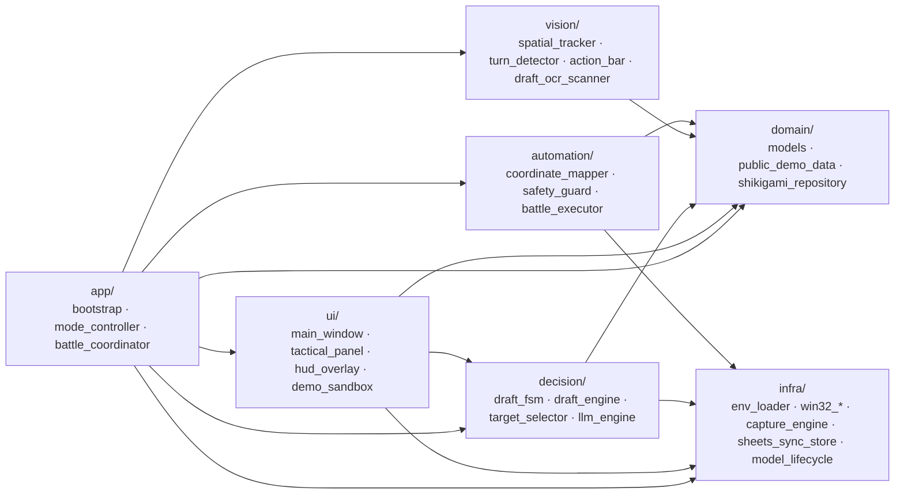
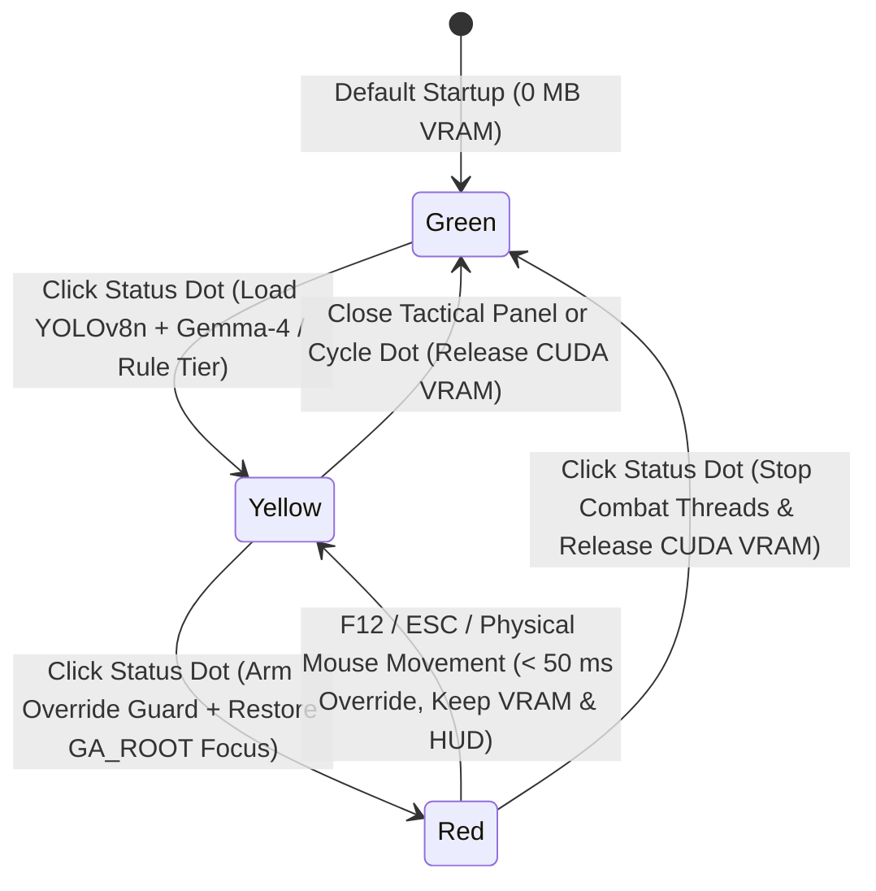

# Architecture & Core Algorithms Whitepaper

This document details the production-oriented modular architecture, mathematical decision models, `YOLOv8n` training & occlusion-tracking pipeline, mixed-DPI coordinate projections, concurrency invariants, and native `.pyd` compilation workflow of **Onmyoji Tactical Helper**.

---

## 1. Production-Oriented 7-Layer Modular Architecture

The codebase enforces a strict unidirectional dependency graph (`app / ui` $\to$ `decision / vision / automation` $\to$ `domain / infra`). Core symbolic decision engines, finite-state machines, and spatial trackers remain decoupled from Win32 window handles, GDI surfaces, and Tkinter widgets—enabling deterministic, sub-second CI verification on headless runners.

### Key Architectural Invariants
1. **Zero Import-Time Side Effects**: Process DPI awareness, OpenMP/BLAS thread-pool caps, rotating log handlers, and neural runtimes (`RapidOCR`, `YOLOv8n`, `Gemma-4`) are never initialized at module import time; all runtime wiring is deferred to `bootstrap.run_application()` or lazy per-engine initialization.
2. **Dual-Track Configuration Isolation (`infra/env_loader.py`)**:
   - **Private Cloud Track**: When an untracked `.env` file (`<project_root>/.env` or `<exe_dir>/data/.env`) defines `ONMYOJI_SHEET_*` and `ONMYOJI_AUTH_CSV_URL`, `SheetsSyncStore` synchronizes live 251-unit metadata and playbooks into a local AppData cache obfuscated via vectorized NumPy XOR (`np.bitwise_xor`, ~50x faster than Python byte loops), while `AuthService` validates the hardware SHA-256 Machine ID (`wmic csproduct get uuid` with `Cryptography\MachineGuid` fallback for Windows 11 24H2+).
   - **Public Sandbox Track**: When `.env` is absent (default after `git clone`) or `--demo` is passed, the application skips UAC elevation and network sync, loading `domain/public_demo_data.py` into `ShikigamiRepository` and `DemoSandboxWindow` cleanly.
3. **$O(1)$ Amortized Metadata Queries**: `ShikigamiRepository` pre-sorts full-to-short aliases and multi-character tokens once by descending string length at startup and wraps tag lookups in `@lru_cache(maxsize=512)`, reducing dozens of per-frame combat queries to $< 0.02\text{ ms}$.

---

## 2. XMind Counter-Tree & Mirror-Match Mathematical Model (`decision/draft_engine.py`)

Competitive PvP drafting playbooks form a causal counter-pick tree partitioned by the opponent's Ban root:
- **Ally Lineup $M = (m_0, m_1, m_2, m_3, m_4)$** is modeled as a **strictly ordered 5-step counter-chain backbone**.
- **Opponent Lineup $O = \{o_1, \dots, o_5\}$** is modeled as an **order-invariant opening formation set**, eliminating combinatorial noise when opponents permute their first three picks.

### 2.1 Global Strict Availability Mask
Let $b_{\text{opp}}$ and $b_{\text{my}}$ denote banned cards, and let $P_{\text{my}}, P_{\text{opp}}$ denote revealed picks. Every candidate recommendation or prediction $c$ is filtered against the hard exclusion mask $U$:

$$
U = \{b_{\text{opp}}, b_{\text{my}}\} \cup P_{\text{my}} \cup P_{\text{opp}}, \qquad c \notin U
$$

### 2.2 Branch Weighting & Dead-Branch Viability Decay
For any playbook branch $(M, O)$ evaluated at draft step $k = |P_{\text{my}}|$, its composite branch weight $W_{\text{branch}}$ combines ordered ally prefix adherence $S_{\text{backbone}}$, unordered opponent precision/recall $S_{\text{opp}}$, Ban-root affinity $\mu_{\text{ban}}$, and an endgame viability decay factor $\gamma_{\text{viability}}$:

$$
W_{\text{branch}} = \left( S_{\text{backbone}}(M, P_{\text{my}}) + S_{\text{opp}}(O, P_{\text{opp}}) \right) \cdot \mu_{\text{ban}} \cdot \gamma_{\text{viability}}
$$

Whenever unpicked core cards in $R_{\text{my}} = M \setminus P_{\text{my}}$ have been banned ($n_{\text{ban}}$) or stolen by the opponent ($n_{\text{stolen}}$), $\gamma_{\text{viability}}$ applies exponential decay so broken branches yield to intact pivot branches:

$$
\gamma_{\text{viability}} = (0.12)^{n_{\text{ban}}} \cdot (0.18)^{n_{\text{stolen}}} \cdot \eta_{\text{next}} \cdot \eta_{\text{opp\_ban}}
$$

where $\eta_{\text{next}} = 0.35$ if the immediate next slot $m_k \in U$ (else $1.0$), and $\eta_{\text{opp\_ban}} = 0.55$ if $O \cap \{b_{\text{opp}}, b_{\text{my}}\} \neq \emptyset$ (else $1.0$).

### 2.3 Top-Tier Quadratic Sharpening & Mirror Detection
Branches within $50\%$ of the dominant weight $W_{\max}$ are aggregated via quadratic sharpening:

$$
S(c) = \sum_{i \in \mathcal{T}_c} W_i \cdot \left(\frac{W_i}{W_{\max}}\right)^2
$$

Simultaneously, a parallel **Mirror / Copycat Detector** evaluates $P_{\text{opp}} \cap \text{set}(M)$ across our own recorded ally backbones (boosted by $+35.0$ per Turn-1/2 opener match). When mirror weight dominates or reaches $\ge 85\%$ of standard opponent-column weight with $\ge 2$ hits, the engine emits a `[鏡像/內戰]` alert and predicts the opponent's remaining cards directly from our own $M$ chain.

---

## 3. Custom `YOLOv8n` Detector, 2D Affine Stabilization & Geometric Verification (`vision/`)

### 3.1 `YOLOv8n` Architecture, Augmentation & Validation Metrics
To fit strictly inside a single-PC frame budget alongside a live 60 FPS game client, unit detection uses a custom-trained **`YOLOv8n`** nano detector (`best.pt`, `5.9 MB`, `imgsz=640`, `150 epochs`, classes `{0: enemy, 1: ally}`).

- **Augmentation Pipeline**: Trained with `mosaic = 1.0` (dense 5v5 overlap), aggressive HSV color-space perturbation (`hsv_h = 0.015`, `hsv_s = 0.70`, `hsv_v = 0.40` to build invariance against high-luminance ultimate VFX), geometric translation/scaling (`translate = 0.10`, `scale = 0.20`), and horizontal flip (`fliplr = 0.50`).
- **Validation Performance**: Achieves **`mAP@50 = 99.5%`**, **`Recall = 93.5%`**, **`Precision = 89.0%`**, and **`mAP@50-95 = 60.1%`**. While ornate character skins and floating particle halos introduce tight-IoU variance (`mAP@50-95`), high centroid recall (`93.5%` / `99.5% @ IoU=0.50`) provides reliable spatial observations for our downstream affine tracker.

### 3.2 2D Partial Affine Stabilization & `3.5s` Occlusion Continuity (`StateParser`)
During 5v5 combat, ultimate animations trigger camera zoom/pan motion and multi-second particle blackouts:

1. **Dynamic Baseline Anchoring**: Once 5 units of a camp are localized, `StateParser` locks an initial horizontal baseline $\{p_i^{(0)}\}_{i=1}^5$ (automatically rescaling anchors proportionally if the window is resized mid-match).
2. **2D Partial Affine Camera Solve**: Whenever at least 3 units are visible on frame $t$, `cv2.estimateAffinePartial2D` solves the 4-DoF transformation matrix $\mathbf{H}_t \in \mathbb{R}^{2 \times 3}$ (scale, rotation, translation) mapping baseline anchors to current frame coordinates, projecting occluded unit positions $\hat{p}_k^{(t)}$:

$$
\hat{p}_k^{(t)} = \mathbf{H}_t \begin{bmatrix} p_{k,x}^{(0)} \\ p_{k,y}^{(0)} \\ 1 \end{bmatrix}
$$

3. **Symmetric EMA Trajectories & `3.5s` Grace Recovery**: Both ally and enemy camps maintain exponential moving average positions (`smooth_pos_my`, `smooth_pos_opp`). If a unit vanishes due to ultimate VFX ($\Delta t < 3.5\text{ s}$), its alive state and coordinates recover via $\hat{p}_k^{(t)} \to \text{EMA}_k \to p_k^{(0)}$, maintaining `100%` slot continuity (`<= 4 px` drift in `tests/test_vision_replay.py`) before transitioning genuinely defeated units ($\Delta t \ge 3.5\text{ s}$) to `alive = False`.

### 3.3 Circumferential Sobel Turn & Skill-Slot Verifier (`TurnDetector`)
Rather than brittle pixel-color polling, `TurnDetector` combines `CLAHE` (`clipLimit=2.5`), `HoughCircles`, and a **16-point circumferential Sobel gradient check** (`>= 7/16` perimeter samples with $\|\nabla I\| \ge 32.0$ plus pairwise radius/vertical colinearity `r_diff <= 12%`, `y_diff <= 8%`). This rejects full-screen bright VFX flashbangs while dynamically distinguishing 3-skill vs. 4-skill unit layouts and classifying orb/cooldown availability in HSV space (`V_mean >= 75`, `V_90 >= 110`, `S_mean >= 30 | S_85 >= 45`).

---

## 4. Mixed-DPI Coordinate Projection & Deterministic Fail-Safe Guardrails (`automation/` & `ui/`)

### 4.1 Unified DWM DPI & Letterbox Physical Projection (`CoordinateMapper`)
On displays with Windows DWM scaling (e.g., `125%` or `150%`), GDI `BitBlt` against a non-DPI-aware application surface captures logical buffer dimensions $(W_{\text{cap}}, H_{\text{cap}})$ before `CaptureEngine` strips black letterbox bars $(x_0, y_0)$, whereas `GetClientRect` under our Per-Monitor DPI v2 process returns physical client pixels $(W_{\text{phys}}, H_{\text{phys}})$.

Both `BattleOverlayUI` and `CoordinateMapper` invoke `project_cropped_to_physical_client`, computing exact DWM scale factors from the uncropped capture frame $W_{\text{cap}} = W_{\text{img}} + 2x_0$:

$$
X_{\text{client}} = (x_0 + x_{\text{img}}) \cdot \frac{W_{\text{phys}}}{W_{\text{img}} + 2x_0}, \qquad
Y_{\text{client}} = (y_0 + y_{\text{img}}) \cdot \frac{H_{\text{phys}}}{H_{\text{img}} + 2y_0}
$$

Screen coordinates are translated via `ClientToScreen` and clamped within the intersection of the client rect and `GetAncestor(hwnd, GA_ROOT)` root window bounds—preserving 1:1 alignment across `16:9`, `16:10` (`1920×1200`), and negative-coordinate multi-monitor setups.

### 4.2 Smooth Cursor Interpolation, UI Hover Stabilization & Human-in-the-Loop Controls
- **Smooth Cursor Interpolation & UI Hover Stabilization**: DirectX/Messiah UI frameworks update hover hitboxes asynchronously on mouse-move messages. `win32_input.py` interpolates cursor motion smoothly to the target control and emits a zero-delta `MOUSEEVENTF_MOVE` hover stabilization pulse (`35–50 ms`) prior to `SendInput` button dispatch so UI hover states register reliably without dropped clicks.
- **Unified 2-Step Dispatch & `S1` Fallback**: Single-target skills, enemy AoE (`敵方全體`), and ally AoE (`我方全體`) follow a unified 2-step sequence (**Step 1: Alive Unit Lock** $\to$ **Step 2: Skill Button Dispatch**). When `S2/S3/S4` are unavailable due to insufficient orbs or cooldown, `AutoBattleExecutor` automatically falls back to `[S1]` normal attack on the highest-priority alive enemy unit.
- **Human-in-the-Loop Override & Turn Latch**: Every dispatch engages a `>= 2.2s` cooldown timer and a `True -> False -> True` turn-edge latch (`5.5s` extra-turn escape hatch), while `SafetyGuard` polls `F12`, `ESC`, and physical cursor displacement every `50 ms` to yield control back to passive Yellow Mode immediately.

---

## 5. Threading Model, Lock Hierarchy & Resource Symbiosis

| Thread Name | Cadence / Trigger | Synchronization Boundary & Responsibility |
| :--- | :--- | :--- |
| **`MainThread` (Tkinter)** | `50 ms` UI queue drain + `.after(0)` | Sole owner of Tkinter widgets and Canvas primitives; floating panels apply 64-bit safe `WS_EX_NOACTIVATE` post-`deiconify()`. |
| **`ocr_worker`** | `0.9s / 1.3s / 2.5s / 4.5s` | Executes GDI draft capture, motion-diff gating, `RapidOCR`, and `DraftStateMachine`; publishes immutable tuples over `queue.Queue`. |
| **`BattleCoordinatorLoop`** | `0.25s` (ally) / `0.60s` (enemy) | Acquires `yolo_lock` for `YOLOv8n` + affine tracking; guards shared slot dictionaries via re-entrant `_state_lock (RLock)`. |
| **`AsyncGemmaWorker`** | On turn edge (`>= 3.0s` cooldown) | Acquires independent `llm_lock` for Gemma-4 GGUF completion so LLM prefill never blocks `0.25s` HUD tracking. |
| **`RedModeKillSwitch`** | `50 ms` `GetAsyncKeyState` poll | Monitors `F12` / `ESC` override keys; increments `ModeController._transition_epoch` and atomically disarms `auto_battle_enabled`. |

---

## 6. Native Binary Compilation & IP Protection (`build_release.py`)

1. **Sequential Low-RAM Cython 3.3 Compilation**: Discovers all **33 modules** under `src/onmyoji_helper/` and compiles each inside an isolated child process (`--workers 1` default) into native Windows `.pyd` C-extensions with `docstrings=False`, `binding=False`, `c_line_in_traceback=False`, `emit_code_comments=False`, MSVC `/O2 /DNDEBUG`, and `/DEBUG:NONE` symbol stripping for source-level IP protection.
2. **PyInstaller Standalone Packaging**: Packages `OnmyojiHelper.exe` with `--onedir --windowed --uac-admin --contents-directory=data`, embedding the Windows `requireAdministrator` PE `RT_MANIFEST` and copying `best.pt` (plus local `.env` into `data/.env` when present) directly without archive re-compression.
3. **Automated Post-Build Hygiene Audit**: Verifies root directory cleanliness (`['OnmyojiHelper.exe', 'data']`), `requireAdministrator` manifest presence, `33/33` `.pyd` module completeness, and **zero `.py` source files** in the release directory.
